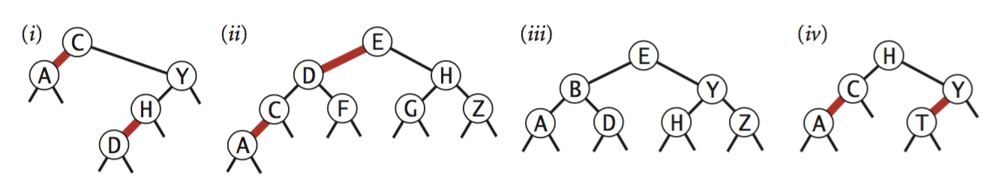

.. _part3_ex1:

Exercises A
=======================================

.. note::
    You must complete these exercises by Wednesday of W6.

SequentialSearchST vs. BinarySearchST
"""""""""""""""""""""""""""""""""""""

Which of the two implementations, ``SequentialSearchST`` or ``BinarySearchST``, would you use for an application
that performs :math:`10^3` ``put()`` and :math:`10^6` ``get()`` operations in random order? Justify your choice.

.. answer::

    * **For ``SequentialSearchST``** (unordered linked list):

      * Search (``get``): :math:`N` (worst case), :math:`N/2` (average case)
      * Insert (``put``): :math:`N` (worst and average case, as it scans the list to check for an existing key)

    * **For ``BinarySearchST``** (ordered parallel arrays with binary search):

      * Search (``get``): :math:`\log_2 N` (worst and average case)
      * Insert (``put``): :math:`\sim 2N` array accesses in the worst case and :math:`\sim N` in the average case (to shift larger keys and values to the right, assuming amortized :math:`\mathcal{O}(1)` array resizing).

    For a table of size :math:`M` (at most :math:`10^3`), performing :math:`10^3` ``put()`` and :math:`10^6` ``get()`` operations costs approximately:

    .. math::

        \text{Total cost} \approx 10^3 \cdot I(M) + 10^6 \cdot S(M)

    * ``SequentialSearchST``: :math:`\approx 10^3 \cdot M + 10^6 \cdot (M/2) \approx 5 \cdot 10^8` operations for :math:`M \approx 10^3`.
    * ``BinarySearchST``: :math:`\approx 10^3 \cdot M + 10^6 \cdot \log_2(M) \approx 10^6 + 10^7 \approx 1.1 \cdot 10^7` operations.

    Because ``get()`` operations outnumber ``put()`` operations by a factor of :math:`1000`, **``BinarySearchST`` is overwhelmingly faster**.

Interpolation Search
""""""""""""""""""""

*Exercise 3.1.24 of the book*.

Assume the keys are doubles or integers. Write a version of binary search that assumes
a uniform distribution of keys and will thus first look at the beginning of a dictionary for a word that begins with a letter close to the beginning of the alphabet.

More precisely, if the searched key is :math:`k_x`, the smallest key is :math:`k_{lo}`, and the largest
key is :math:`k_{hi}`, interpolation search will first probe at the key at index fraction :math:`\lfloor (k_x-k_{lo})/(k_{hi}-k_{lo}) \cdot (\text{length}-1) \rfloor` of the array
instead of probing the middle (50th percentile) first.

Implement ``InterpolationSearchST`` and compare this on ``FrequencyCounter``.

.. answer::

    We keep the same structure as ``BinarySearchST`` (pages 379–380 of the textbook) and replace the midpoint calculation in ``rank`` with the interpolated position:

    .. code-block:: java

        public int rank(Integer key) {
            int lo = 0, hi = N - 1;
            while (lo <= hi) {
                if (lo == hi || keys[lo].equals(keys[hi])) {
                    return key.compareTo(keys[lo]) <= 0 ? lo : lo + 1;
                }
                if (key.compareTo(keys[lo]) <= 0) return lo;
                if (key.compareTo(keys[hi]) > 0)  return hi + 1;

                double fraction = (double) (key - keys[lo]) / (keys[hi] - keys[lo]);
                int mid = lo + (int) Math.floor(fraction * (hi - lo));

                int cmp = key.compareTo(keys[mid]);
                if (cmp < 0)      hi = mid - 1;
                else if (cmp > 0) lo = mid + 1;
                else              return mid;
            }
            return lo;
        }

    **Performance discussion**:

    * On uniformly distributed numeric keys, interpolation search performs :math:`\mathcal{O}(\log \log N)` comparisons on average (though :math:`\mathcal{O}(N)` in the worst case if keys are skewed).
    * However, in ``FrequencyCounter``, inserting a new key into ``BinarySearchST`` or ``InterpolationSearchST`` still requires shifting :math:`\mathcal{O}(N)` array elements, which completely dominates the search time.

Software Caching in BinarySearchST
""""""""""""""""""""""""""""""""""

*Exercise 3.1.25 of the book*.

It is very common to first test the presence of a key before adding or modifying the corresponding entry. That
practice generates several consecutive searches for the same key.

The idea of *caching* is to store the last accessed key internally
and to use it opportunistically if it is still valid.
Modify ``BinarySearchST`` to incorporate this idea.

.. answer::

    Add an instance variable ``int cache = 0;`` (storing the index of the most recently accessed key) to ``BinarySearchST``.
    At the beginning of ``get(Key key)`` and ``put(Key key, Value val)``, before calling ``rank(key)``, check whether ``cache < N && keys[cache].compareTo(key) == 0``. If so, use ``cache`` directly in :math:`\Theta(1)` time; otherwise, call ``rank(key)`` and update ``cache`` to the index of the found or inserted key.

Validating a Binary Search Tree
"""""""""""""""""""""""""""""""

*Exercise 3.2.31 of the book*.

Write an ``isBST()`` method that takes a ``Node`` as an argument and returns ``true`` if the argument is the root of a valid BST, and ``false`` otherwise (i.e., verify that all properties of a BST are satisfied).

Do you think that testing (locally) for each node the property *"the left child has a smaller key and the right child has a greater key"* is sufficient? If not, give a counterexample.

What is the time complexity of your algorithm?

.. answer::

    * **Why a local check is insufficient**: Every key in the *entire* left subtree of a node ``x`` must be strictly smaller than ``x.key``, not just ``x.left.key``.
      *Counterexample*: Consider a tree with root ``10``, left child ``5``, and ``12`` as the right child of ``5``. Locally, ``5 < 10`` and ``12 > 5``, yet ``12`` is in the left subtree of ``10`` while ``12 > 10``, so this is **not** a valid BST!
    * **Correct implementation** (passing down the valid range ``(min, max)`` for each subtree, page 420 of the textbook):

      .. code-block:: java

          public boolean isBST() {
              return isBST(root, null, null);
          }

          private boolean isBST(Node x, Key min, Key max) {
              if (x == null) return true;
              if (min != null && x.key.compareTo(min) <= 0) return false;
              if (max != null && x.key.compareTo(max) >= 0) return false;
              return isBST(x.left, min, x.key) && isBST(x.right, x.key, max);
          }

    * **Time complexity**: :math:`\Theta(N)` in the worst case, since each node in the tree is visited at most once.

Valid BST Search Key Sequences
""""""""""""""""""""""""""""""

*Exercise 3.2.4 of the book*.

Suppose a certain search tree has keys between 1 and 10 and we are looking for key 5.
Which sequence(s) cannot match the sequence of the examined keys?

* a) ``10, 9, 8, 7, 6, 5``
* b) ``4, 10, 8, 6, 5``
* c) ``1, 10, 2, 9, 3, 8, 4, 7, 6, 5``
* d) ``2, 7, 3, 8, 4, 5``
* e) ``1, 2, 10, 4, 8, 5``

.. answer::

    Only sequence **d) ``2, 7, 3, 8, 4, 5`` is impossible**.
    When searching for ``5``: after examining ``7`` (since ``5 < 7``), the search moves into the **left subtree** of ``7``, meaning all subsequently examined keys must be strictly less than ``7``. However, ``8`` appears later in the sequence (after ``3``), which violates the BST ordering property (:math:`8 \notin (3, 7)`). All other sequences maintain a valid shrinking interval :math:`(\text{min}, \text{max})` containing ``5``.

Validating a Red-Black BST
""""""""""""""""""""""""""

*Exercise 3.3.33 of the book*.

Write a method ``is23()`` in ``RedBlackBST`` that checks that no node is connected
to two red links and that there is no red link to the right.
Also write a method ``isBalanced()`` that checks that any path from the root to a null link has the
same number of black links. Finally, combine ``isBST()``, ``is23()``, and ``isBalanced()`` to implement ``isRedBlackBST()``.

.. answer::

    .. code-block:: java

        public boolean isRedBlackBST() {
            return isBST() && is23() && isBalanced();
        }

        private boolean is23() {
            return is23(root);
        }

        private boolean is23(Node x) {
            if (x == null) return true;
            if (isRed(x.right)) return false;                  // no right-leaning red link
            if (x != root && isRed(x) && isRed(x.left)) return false; // no two consecutive red links
            return is23(x.left) && is23(x.right);
        }

        private boolean isBalanced() {
            int blackHeight = 0; // count black links on the leftmost path
            Node x = root;
            while (x != null) {
                if (!isRed(x)) blackHeight++;
                x = x.left;
            }
            return isBalanced(root, blackHeight);
        }

        private boolean isBalanced(Node x, int blackHeight) {
            if (x == null) return blackHeight == 0;
            if (!isRed(x)) blackHeight--;
            return isBalanced(x.left, blackHeight) && isBalanced(x.right, blackHeight);
        }

Enumerating BST Keys in Ascending Order
"""""""""""""""""""""""""""""""""""""""

How can you enumerate all stored keys in ascending order
in a binary search tree? What is the time complexity of
this operation? Justify your answer.

.. answer::

    Perform an **in-order traversal** of the BST: recursively traverse the left subtree, visit/enqueue the current node's key, and recursively traverse the right subtree.
    By the BST invariant (all keys in the left subtree are smaller than the root, and all keys in the right subtree are larger), this visits all :math:`N` keys in strictly ascending order.

    **Time complexity**: :math:`\Theta(N)` because every node is visited a constant number of times (and each of the :math:`2N` links is traversed once).

BST vs. 2-3 Tree Insertion Trace
""""""""""""""""""""""""""""""""

Starting from an initially empty binary search tree, what does the tree look like
after inserting the keys 12, 5, 10, 3, 13, 14, 15, 17, 18, 15?
For the same data, what would the tree look like for a 2-3 tree?

Does this example illustrate the advantages or disadvantages of these different data structures? Why?

.. answer::

    * **Standard Binary Search Tree (BST)**:

      .. image:: 9a.png

    * **2-3 Search Tree**:

      .. image:: 9b.png

      .. image:: 9c.png

    * **Discussion**: Because the inserted keys ``13, 14, 15, 17, 18`` arrive in strictly increasing order, the right branch of the standard BST degenerates into a linear chain of height :math:`\mathcal{O}(N)`. In contrast, the 2-3 tree splits 4-nodes from the bottom up, maintaining perfect balance and logarithmic height :math:`\mathcal{O}(\log N)` regardless of insertion order.

Identifying Valid Red-Black BSTs
""""""""""""""""""""""""""""""""

Which of these trees are red-black BSTs? For each, draw the corresponding 2-3 tree
(described on page 432).

.. answer::

    Only trees **(iii)** and **(iv)** are valid Left-Leaning Red-Black BSTs:

    * **(i) Invalid**: Does not have perfect black balance (paths from the root to null links have different numbers of black links).
    * **(ii) Invalid**: Not black-balanced, has a right-leaning red link, and violates the BST key ordering (``F`` is in the left subtree of ``E``).
    * **(iii) Valid Red-Black BST**.
    * **(iv) Valid Red-Black BST**.

    Corresponding 2-3 representations:

    .. image:: tree_i.png
    .. image:: tree_ii.png
    .. image:: tree_iii.png
    .. image:: tree_iv.png

MCQ on Tree Traversals
""""""""""""""""""""""

`Binary search tree traversals <https://inginious.info.ucl.ac.be/course/LINFO1121-QCM/PART3QcmBt>`_

BST Iterator
""""""""""""

`Implement an iterator for a BST <https://inginious.info.ucl.ac.be/course/LINFO1121/searching_BinarySearchTreeIterator>`_

Ceil
""""""""""

`Implement the ceil method <https://inginious.info.ucl.ac.be/course/LINFO1121/searching_BinarySearchTree>`_ of a Binary Search Tree (and ``BinarySearchST``).

.. answer::

    * **In a linked ``BinarySearchTree``**:

      .. code-block:: java

          public Key ceil(Key key) {
              Node x = ceil(root, key);
              return x == null ? null : x.key;
          }

          private Node ceil(Node x, Key key) {
              if (x == null) return null;
              int cmp = key.compareTo(x.key);
              if (cmp == 0) return x;
              if (cmp > 0)  return ceil(x.right, key);
              Node t = ceil(x.left, key);
              return (t != null) ? t : x;
          }

    * **In array-based ``BinarySearchST``**: ``rank(key)`` returns the number of keys strictly smaller than ``key``, which is the exact index of the smallest key :math:`\ge \text{key}` (or ``N`` if all keys are smaller):

      .. code-block:: java

          public Key ceiling(Key key) {
              int i = rank(key);
              if (i == N) return null;
              return keys[i];
          }

Higher Key
""""""""""

Implement a method that returns the least key strictly greater than a given key:
`Higher key <https://inginious.info.ucl.ac.be/course/LINFO1121/searching_BinarySearchTreeHigher>`_

MCQ on BST Time Complexity
""""""""""""""""""""""""""

`Time complexity of binary search trees <https://inginious.info.ucl.ac.be/course/LINFO1121-QCM/PART3Qcm>`_

Red-Black Tree Insertions
"""""""""""""""""""""""""

`Red-black tree insertions <https://inginious.info.ucl.ac.be/course/LINFO1121-QCM/PART3Rbt>`_

Red-Black Tree Conversion
"""""""""""""""""""""""""

Implement a class that converts a 2-3 tree into a red-black tree:
`RedblackTreeConverter <https://inginious.info.ucl.ac.be/course/LINFO1121/searching_RedBlackTreeConverter>`_
