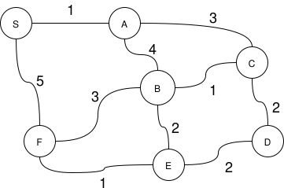

.. _part6_ex2:

Exercises B
=======================================

.. note::
    You must complete these exercises by Wednesday of W13.

Dijkstra Revisited
""""""""""""""""""

We are interested in the implementation of Dijkstra's algorithm on page 655.

* What is the time complexity of this algorithm?
* Rewrite this algorithm using only auxiliary collections from ``java.util``. Specifically, replace ``IndexMinPQ`` with a standard collection from ``java.util``.

.. answer::

    * **Time complexity**: :math:`\mathcal{O}((V + E) \log V)` time and :math:`\mathcal{O}(V + E)` space using ``java.util.PriorityQueue`` (see *Complexity of Dijkstra's Algorithm* in Exercises A).
    * **Java implementation with ``java.util.PriorityQueue``**:

      .. code-block:: java

          public class DijkstraJavaUtil {
              private double[] distTo;
              private DirectedEdge[] edgeTo;

              private static class Node implements Comparable<Node> {
                  final int v;
                  final double dist;
                  Node(int v, double dist) { this.v = v; this.dist = dist; }
                  public int compareTo(Node other) {
                      return Double.compare(this.dist, other.dist);
                  }
              }

              public DijkstraJavaUtil(EdgeWeightedDigraph G, int s) {
                  distTo = new double[G.V()];
                  edgeTo = new DirectedEdge[G.V()];
                  Arrays.fill(distTo, Double.POSITIVE_INFINITY);
                  distTo[s] = 0.0;

                  PriorityQueue<Node> pq = new PriorityQueue<>();
                  pq.add(new Node(s, 0.0));

                  while (!pq.isEmpty()) {
                      Node current = pq.poll();
                      int v = current.v;
                      if (current.dist > distTo[v]) continue; // skip outdated lazy entry

                      for (DirectedEdge e : G.adj(v)) {
                          int w = e.to();
                          if (distTo[v] + e.weight() < distTo[w]) {
                              distTo[w] = distTo[v] + e.weight();
                              edgeTo[w] = e;
                              pq.add(new Node(w, distTo[w]));
                          }
                      }
                  }
              }
          }

String of Fairy Lights
""""""""""""""""""""""

The INGI department has acquired a string of fairy lights for Christmas to decorate the Réaumur building.
The lights form a graph with a lamp at each vertex.
When turned on, an initial lamp is chosen at random, and every second thereafter, all lamps adjacent to currently lit lamps are switched on in turn.
Implement the ``minTime`` method answering the following question:
*What is the minimum number of seconds required for the entire string of lights to be fully illuminated, given an optimal starting lamp?*

Here is the method signature:

.. code-block:: java

  public int minTime(Graph G);

You may assume the ``Graph`` API as described in the textbook.
Assume that the graph :math:`G` is connected.

* What is the time complexity of your algorithm?

.. answer::

    If lamp :math:`s` is chosen as the initial lamp, the time required for all lamps to be lit equals the maximum shortest-path distance :math:`\text{eccentricity}(s) = \max_{v \in V} \text{dist}(s, v)` from :math:`s`, which can be computed in :math:`\Theta(V + E)` time using **Breadth-First Search (BFS)** from :math:`s`.
    To find the minimum time over all possible starting lamps (the **radius** of the graph :math:`\min_{s \in V} \max_{v \in V} \text{dist}(s, v)`), we run BFS from each vertex :math:`s \in \{0, \dots, V - 1\}`:

    .. code-block:: java

        public int minTime(Graph G) {
            int minMaxDist = Integer.MAX_VALUE;
            for (int s = 0; s < G.V(); s++) {
                int[] distTo = new int[G.V()];
                Arrays.fill(distTo, -1);
                Queue<Integer> q = new ArrayDeque<>();
                q.add(s);
                distTo[s] = 0;
                int maxDist = 0;

                while (!q.isEmpty()) {
                    int v = q.poll();
                    maxDist = Math.max(maxDist, distTo[v]);
                    for (int w : G.adj(v)) {
                        if (distTo[w] == -1) {
                            distTo[w] = distTo[v] + 1;
                            q.add(w);
                        }
                    }
                }
                minMaxDist = Math.min(minMaxDist, maxDist);
            }
            return minMaxDist;
        }

    * **Time complexity**: Running :math:`V` Breadth-First Searches takes :math:`\Theta(V(V + E))` time and :math:`\Theta(V)` extra space.

Maximizing the Minimum Edge Weight
""""""""""""""""""""""""""""""""""

Let :math:`G` be an undirected graph with positive edge weights.
Given a source vertex :math:`S`, we want to find a path to each vertex that maximizes *the minimum edge weight on that path*.

For example, in this graph, :math:`S-F-B-A-C-D` is such a path, with a bottleneck edge weight of 2.

Can you adapt an algorithm seen in class to find such paths to each vertex?

Hint: Consider the properties of the weights. How does this compare to shortest path algorithms (or MST algorithms)?

.. answer::

    This is the **Widest Path (or Maximum Capacity / Bottleneck Path) problem**. It can be solved in two ways:

    1. **Adaptation of Dijkstra's Algorithm** (:math:`\mathcal{O}((V + E) \log V)`):
       Instead of minimizing the sum of edge weights along a path, we **maximize the minimum edge weight** along the path:

       * Initialize ``maxMinWeight[S] = Double.POSITIVE_INFINITY`` and ``maxMinWeight[v] = 0.0`` for all :math:`v \neq S`.
       * Use a **Max-Priority Queue** (ordering vertices by decreasing ``maxMinWeight[v]``).
       * Relaxation condition for an edge :math:`e = (v, w)` of weight :math:`w(e)`:

         .. code-block:: java

             double candidate = Math.min(maxMinWeight[v], e.weight());
             if (candidate > maxMinWeight[w]) {
                 maxMinWeight[w] = candidate;
                 edgeTo[w] = e;
                 pq.insert(w, maxMinWeight[w]);
             }

    2. **Maximum Spanning Tree (Prim's or Kruskal's Algorithm)**:
       By the Cut Property, the path between :math:`S` and any vertex :math:`v` in a **Maximum Spanning Tree** (found by running Prim's or Kruskal's algorithm with negated weights or reversed comparisons) automatically maximizes the minimum edge weight along the path!

Mine Climbing
"""""""""""""

A programming exercise on shortest paths with implicit graphs (exam 2018):
`MineClimbing <https://inginious.info.ucl.ac.be/course/LINFO1121/graphs_MineClimbing>`_.

Train Network
"""""""""""""

A challenging shortest-path problem in a public transport network (exam 2019):
`Trains <https://inginious.info.ucl.ac.be/course/LINFO1121/graphs_Trains>`_.

Word Transformation
"""""""""""""""""""

A string transformation problem modeled as a shortest-path problem on a graph:
`Words <https://inginious.info.ucl.ac.be/course/LINFO1121/graphs_WordTransformationSP>`_.

Galaxy Path
"""""""""""

Help humanity discover a new habitable galaxy by solving a hyperspace shortest-path problem (exam 2021):
`GalaxyPath <https://inginious.info.ucl.ac.be/course/LINFO1121/graphs_GalaxyPath>`_.

Task Scheduler
""""""""""""""

A topological sorting problem to verify whether a course programme complies with university prerequisite constraints (exam 2022):
`TaskScheduler <https://inginious.info.ucl.ac.be/course/LINFO1121/graphs_TaskScheduler>`_.

Olympic Evacuation
""""""""""""""""""

Help Olympic organizers plan efficient evacuation routes:
`Evacuation <https://inginious.info.ucl.ac.be/course/LINFO1121/graphs_Evacuation>`_.

Wildfire Spread
"""""""""""""""

Help firefighters model the spread of a forest fire (exam 2022):
`Wildfire <https://inginious.info.ucl.ac.be/course/LINFO1121/graphs_Wildfire>`_.
