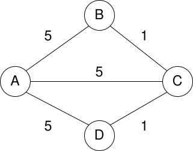
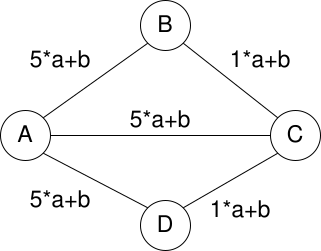

.. _part7_1:

*************************************************************************************************
Part 7: Review Session & QCM
*************************************************************************************************

Recommended plan for the review session:

- **First 20 minutes**: Read and answer the multiple-choice questions (MCQs) individually.
- **Next 20 minutes**: Collective review and discussion of the MCQs. Compare answers within your group and make sure everyone understands the justification for each statement.
- **Remaining 1h20**: Solve the two INGInious programming tasks at the bottom of the page.

Repeated Huffman Compression — Jan 2020
---------------------------------------

Given a text containing only the character ``a`` repeated one million times (:math:`10^6`) and encoded in extended ASCII (one byte per character).
Suppose this text is compressed by applying the Huffman compression algorithm **twice** in succession:

.. code-block:: text

    input --compress--> output1 --compress--> output2
          \-----------> tree1   \-----------> tree2

The serialized trees (``tree1`` / ``tree2``) are not counted in the output sizes (``output1`` / ``output2``).
Note: For a single-character alphabet (or when ``a`` is encoded using 1 bit per occurrence), each character of ``output1`` is grouped into 8-bit bytes before the second compression pass.

Check **all** correct statements. :math:`\text{size}(x)` denotes the length in bits of ``x`` (for example, :math:`\text{size}(\text{input}) = 8 \cdot 10^6`):

- :math:`\Large{\frac{\text{size}(\text{output1})}{\text{size}(\text{input})} \simeq \frac{1}{8}}`
- :math:`\Large{\frac{\text{size}(\text{output1})}{\text{size}(\text{input})} \simeq \frac{1}{2}}`
- :math:`\Large{\frac{\text{size}(\text{output2})}{\text{size}(\text{input})} \simeq \frac{1}{64}}`
- :math:`\Large{\frac{\text{size}(\text{output2})}{\text{size}(\text{input})} \simeq \frac{1}{16}}`
- :math:`\Large{\frac{\text{size}(\text{output2})}{\text{size}(\text{input})} \simeq \frac{1}{8}}`

.. answer::

    Because the input consists exclusively of a single repeated character ``a``, ``output1`` is a stream of :math:`10^6` identical bits (e.g., ``00000000...``), which represents :math:`10^6 / 8` identical bytes ``0x00``.
    Therefore, the second Huffman compression pass sees a file consisting of a single repeated byte ``0x00`` and compresses each 8-bit byte into a 1-bit codeword again!
    Each successive compression divides the bit size by 8, so the correct statements are **1/8** for ``output1`` and **1/64** for ``output2``.

Huffman Trie Deserialization Complexity — Jan 2020
--------------------------------------------------

The header of a file compressed with Huffman coding contains a serialized version of the coding trie obtained via a preorder traversal.

Given that the trie contains :math:`n` nodes in total, what is the tightest time complexity of reconstructing the linked trie from the bit stream using ``readTrie()``?

.. code-block:: java

    private static Node readTrie() {
        boolean isLeaf = BinaryStdIn.readBoolean();
        if (isLeaf) {
            // constructor is (letter, leftNode, rightNode)
            return new Node(BinaryStdIn.readChar(), null, null);
        }
        else {
            return new Node('\0', readTrie(), readTrie());
        }
    }

- :math:`\mathcal{O}(n)`
- :math:`\mathcal{O}(n \log n)`
- :math:`\mathcal{O}(\log n)`
- :math:`\mathcal{O}(n^2)`
- None of the above (:math:`\mathcal{O}(f(n))` where :math:`f(n)` grows faster than :math:`n^2`)

.. answer::

    :math:`\mathcal{O}(n)`. Each recursive call to ``readTrie()`` creates exactly one ``Node`` of the trie and performs :math:`\Theta(1)` work, so for a trie of :math:`n` nodes, ``readTrie()`` is called exactly :math:`n` times.

Huffman Trie Construction Complexity — Jan 2020
-----------------------------------------------

Given a frequency table with :math:`n` non-zero entries (:math:`R = n`), what is the tightest time complexity of building the Huffman trie from the frequency array using ``buildTrie``?

.. code-block:: java

    // build the Huffman trie given frequencies
    private static Node buildTrie(int[] freq) {

        // initialize priority queue with singleton trees
        MinPQ<Node> pq = new MinPQ<Node>();
        for (char c = 0; c < R; c++)
            if (freq[c] > 0)
                pq.insert(new Node(c, freq[c], null, null));

        // merge two smallest trees
        while (pq.size() > 1) {
            Node left  = pq.delMin();
            Node right = pq.delMin();
            Node parent = new Node('\0', left.freq + right.freq, left, right);
            pq.insert(parent);
        }
        return pq.delMin();
    }

- :math:`\mathcal{O}(\log n)`
- :math:`\mathcal{O}(n)`
- :math:`\mathcal{O}(n \log n)`
- :math:`\mathcal{O}(n^2)`
- None of the above (:math:`\mathcal{O}(f(n))` where :math:`f(n)` grows faster than :math:`n^2`)

.. answer::

    :math:`\mathcal{O}(n \log n)`. The initial loop performs :math:`n` heap insertions, and the ``while`` loop runs :math:`n - 1` iterations, each performing two ``delMin()`` and one ``insert()`` on a binary heap of size at most :math:`n` (:math:`\mathcal{O}(\log n)` per heap operation).

True/False: Shortest Paths and MSTs — Jan 2020
----------------------------------------------

Answer True or False. Every word matters!

Grading rule: :math:`20 \cdot \max(0, 2(\frac{x}{n} - 0.5))` where :math:`x` is the number of correctly answered statements out of :math:`n` (random guessing yields 0 on average).

**Example Graph**:

**Linear Transformation**:
By a "linear transformation" with coefficients :math:`a > 0` and :math:`b \ge 0`, we mean replacing the weight :math:`w` of every edge in the graph by :math:`a \cdot w + b`:

- Dijkstra's algorithm finds the shortest path in any graph, including graphs with negative edge weights, as long as there are no negative-weight cycles.

  .. answer::

    **False.** Dijkstra's algorithm can fail on graphs with negative edge weights even when no negative cycle exists (see *Dijkstra and Negative Edge Weights* in Part 6); Bellman-Ford is required in that case.

- Assuming a connected starting graph, an invariant of Prim's algorithm during its execution is that the selected edges always form a single connected tree.

  .. answer::

    **True.** Prim's algorithm grows a single connected tree from the starting vertex one edge at a time (whereas Kruskal's algorithm maintains a forest of trees that gradually merge).

- During its execution on a connected graph with positive edge weights, Dijkstra's algorithm builds a spanning tree of the graph (the shortest-path tree) where every path from the source root to any vertex is a shortest path in the graph.

  .. answer::

    **True.** This is the definition of the Shortest-Path Tree (SPT) built via ``edgeTo[]``.

- The spanning tree generated by Dijkstra's algorithm on a connected positively-weighted graph is always a Minimum Spanning Tree (MST).

  .. answer::

    **False.** In the example graph above (with :math:`x=1, y=2, z=3` and edges :math:`(1,2)=2, (2,3)=2, (1,3)=3`), the MST has edges :math:`(1,2)` and :math:`(2,3)` of total weight :math:`4`, whereas Dijkstra from vertex ``1`` picks edges :math:`(1,2)` and :math:`(1,3)` of total weight :math:`2 + 3 = 5`.

- Dijkstra's algorithm finds the shortest path in all graphs, including those with negative weights.

  .. answer::

    **False.**

- Let :math:`G` be a connected, undirected, positively-weighted graph. If we apply a linear transformation :math:`w' = a \cdot w + b` (with :math:`a > 0` and :math:`b \ge 0`) to all edge weights, the set of Minimum Spanning Trees (MSTs) of the transformed graph is identical to that of the original graph.

  .. answer::

    **True.** Every spanning tree of :math:`G` has the exact same number of edges (:math:`|V| - 1`), so for any spanning tree :math:`T`, its new total weight is :math:`w'(T) = a \cdot w(T) + (|V| - 1)b`. Since :math:`a > 0`, this strictly preserves the relative ordering of edge weights and spanning tree weights!

- Let :math:`G` be a connected, undirected, positively-weighted graph (with a unique shortest path between any pair of vertices). If we apply a linear transformation :math:`w' = a \cdot w + b` (with :math:`a > 0` and :math:`b > 0`) to all edge weights, the shortest paths found by Bellman-Ford are always identical to those of the original graph.

  .. answer::

    **False.** Adding a positive constant bias :math:`b > 0` penalizes a path of :math:`k` edges by :math:`k \cdot b` (see *Shifting Negative Weights for Dijkstra* in Part 6). In the example graph with :math:`a = 1, b = 2`, the 2-edge path :math:`1 - 2 - 3` changes weight from :math:`2 + 2 = 4` to :math:`4 + 4 = 8`, whereas the 1-edge path :math:`1 - 3` changes from :math:`5` to :math:`5 + 2 = 7 < 8`, changing the shortest path! (It only preserves shortest paths if :math:`b = 0`).

True/False: Binary Min-Heaps — Jan 2020
---------------------------------------

Check all correct statements.
In the statements below, heaps are **min-heaps** (smallest element at the root), represented as 1-indexed complete binary tree arrays (root at index 1, children of :math:`i` at :math:`2i` and :math:`2i+1`).

- It is a necessary and sufficient condition for a complete binary tree to be a min-heap that "along every path from the root to a leaf, the node keys are in non-decreasing order".

  .. answer::

    **True.** This is equivalent to the min-heap order property (every node is :math:`\ge` its parent).

- It is a necessary and sufficient condition for a complete binary tree to be a min-heap that "for every node, its children (if any) have keys greater than or equal to its own key".

  .. answer::

    **True.** This is the exact definition of the min-heap property.

- The internal array of a binary min-heap is always sorted in non-decreasing order.

  .. answer::

    **False.** For example, ``[-, 0, 2, 1]`` is a valid min-heap (since ``0 <= 2`` and ``0 <= 1``), but the array is not sorted.

- Any complete binary tree whose internal array is sorted in non-decreasing order forms a valid min-heap.

  .. answer::

    **True.** If :math:`a[1] \le a[2] \le \dots \le a[n]`, then for every node :math:`i`, since :math:`i < 2i < 2i+1`, we automatically have :math:`a[i] \le a[2i]` and :math:`a[i] \le a[2i+1]`.

- Given a binary min-heap of :math:`n > 10` distinct keys, removing the minimum and immediately re-inserting it (``delMin`` followed by ``insert``) always leaves the internal array unchanged.

  .. answer::

    **False.** For example, on ``[-, 0, 2, 1, 3]``, ``delMin()`` moves ``3`` to the root and sinks it via ``1``, giving ``[-, 1, 2, 3]``. Re-inserting ``0`` at index 4 and swimming it to the root yields ``[-, 0, 1, 3, 2]``, which differs from ``[-, 0, 2, 1, 3]``.

- There exists a :math:`\Theta(n)` worst-case time algorithm to build a valid binary min-heap from an unsorted array of :math:`n` elements.

  .. answer::

    **True.** Bottom-up heap construction (Floyd's sink-based heapify, used in the first phase of Heapsort) builds a binary heap in :math:`\Theta(n)` time (see *Bottom-Up Heap Construction in Linear Time* in Part 5).

August 2020 Exam Tasks
----------------------

* `August 2020 Exam — Question 1 <https://inginious.info.ucl.ac.be/course/LSINF1121-2016/E1Q1>`_
* `August 2020 Exam — Question 2 <https://inginious.info.ucl.ac.be/course/LSINF1121-2016/E1Q2>`_
